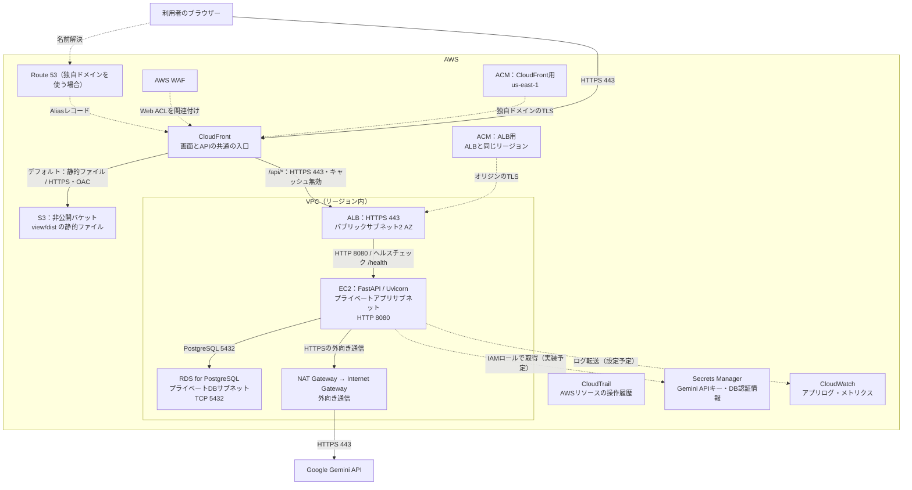
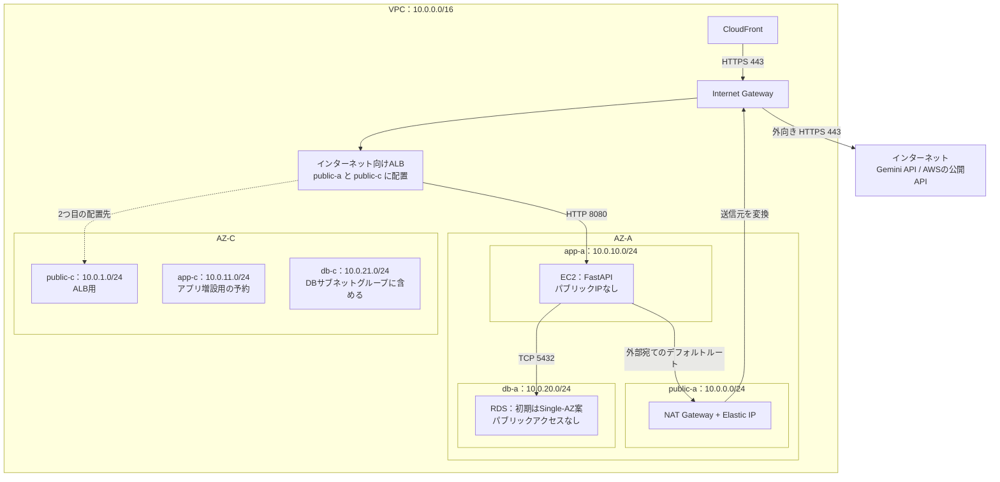

# AWS構成図

AWS上へ配置する際の設計案です。AWSリソースの作成状況を示す図ではありません。

## 設計の根拠

- [Issue #1: バックエンドAPI仕様](https://github.com/togo0214P/AWS_WordExplainer/issues/1): EC2でAPIを実行し、RDS for PostgreSQLに保存する。説明生成だけでは保存せず、画面で承諾してから保存する。
- [Issue #12: Gemini API連携](https://github.com/togo0214P/AWS_WordExplainer/issues/12): 外部の説明生成サービスにはGemini APIを使い、APIキーはサーバー側で管理する。
- [Issue #16: 画面仕様](https://github.com/togo0214P/AWS_WordExplainer/issues/16): React・TypeScript・Viteの画面を `view/` に配置し、ビルドした静的ファイルをS3に配置する。
- [開発ロードマップ](../aws_word_explainer_roadmap.md): CloudFront、WAF、ALB、非公開のRDS、ACM、Secrets Manager、CloudWatch、CloudTrailを含む完成時の構成。

Issueに記載がないネットワークの詳細は、以下で「提案」として具体化しています。ロードマップのGPT表記は、後続のIssue #12に合わせてGeminiと読み替えます。

## 全体構成

実線はアプリケーションの通信、点線はDNS・証明書・設定・監視との関係を示します。応答はリクエストと逆の経路で返ります。

Route 53はDNSで接続先を案内します。HTTPリクエストはブラウザーからCloudFrontへ送ります。WAFはCloudFrontに関連付けて検査し、S3やALBへの振り分けはCloudFrontが行います。

CloudFrontからS3へはOACでアクセスを許可し、S3のパブリックアクセスはブロックします。S3のWebサイトエンドポイントではなく、通常のバケットのエンドポイントをオリジンに指定します。[AWS公式: S3オリジンへのアクセス制限](https://docs.aws.amazon.com/AmazonCloudFront/latest/DeveloperGuide/private-content-restricting-access-to-s3.html)

## VPC・サブネット構成（提案）

リージョンは東京 `ap-northeast-1`、VPCは `10.0.0.0/16` とする案です。既存ネットワークとの重複を確認してから確定します。AZ名は説明用です。

ALBは2つのAZのパブリックサブネットを使用します。RDSのDBサブネットグループにも2つのAZを含めます。サブネットを複数AZに用意することと、EC2やDB自体を冗長化することは別です。図の初期案はEC2 1台・RDS Single-AZ・NAT Gateway 1台のため、AZ障害への冗長性はありません。冗長化する場合はEC2の複数AZ配置、RDS Multi-AZ、AZごとのNATを検討します。

プライベートサブネットのEC2からGeminiへ接続するため、NAT GatewayとInternet Gatewayを経由します。RDSとの通信はVPC内で完結します。[AWS公式: プライベートサブネットとNATの構成例](https://docs.aws.amazon.com/vpc/latest/userguide/vpc-example-private-subnets-nat.html)

| 対象サブネット | 宛先 | ルートのターゲット | 用途 |
| --- | --- | --- | --- |
| 全サブネット | `10.0.0.0/16` | local | ALB→EC2、EC2→RDSなどのVPC内通信 |
| public-a / public-c | `0.0.0.0/0` | Internet Gateway | ALBの公開経路とNATの外向き経路 |
| app-a / app-c | `0.0.0.0/0` | public-aのNAT Gateway | Gemini APIやAWSの公開APIへの外向き通信 |
| db-a / db-c | VPC外へのデフォルトルートなし | — | アプリからのDB接続をVPC内で受け付ける |

## 通信の許可条件（提案）

| 通信元 | 通信先 | ポート・許可条件 |
| --- | --- | --- |
| ブラウザー | CloudFront | HTTPS 443。HTTPはHTTPSへリダイレクト |
| CloudFront | S3 | HTTPS。OACとバケットポリシーで対象ディストリビューションからの読み取りを許可 |
| CloudFront | ALB | HTTPS 443。ALBのSGはCloudFrontのオリジン向けマネージドプレフィックスリストを許可 |
| ALB | EC2 | HTTP 8080。EC2のSGでALBのSGを送信元として許可 |
| EC2 | RDS | TCP 5432。RDSのSGでEC2のSGを送信元として許可 |
| EC2 | Gemini API / Secrets Manager / CloudWatch等 | HTTPS 443。NAT経由で送信。AWSサービスの利用にはEC2のIAMロールも設定 |

ALBにはCloudFrontだけが付加する秘密のカスタムヘッダーを設定し、一致するリクエストだけをEC2へ転送します。それ以外はALBで403を返します。プレフィックスリストと合わせて、自分のCloudFront経由に制限する案です。ヘッダー値はGitへ記載しません。[AWS公式: ALBへのアクセス制限](https://docs.aws.amazon.com/AmazonCloudFront/latest/DeveloperGuide/restrict-access-to-load-balancer.html)

EC2からRDSへの接続ではTLSを有効化する方針とし、接続設定と証明書の扱いはRDS接続を実装する段階で確定します。

## CloudFront・HTTPS・画面の接続先

| パス | オリジン | 設定案 |
| --- | --- | --- |
| デフォルト `*` | S3 | GET / HEAD。デフォルトルートオブジェクトは `index.html`。アセットはキャッシュし、`index.html` の更新時は再検証または無効化 |
| `/api/*` | ALB | 許可メソッドは7種類すべてを選び、POST / DELETEを通す。キャッシュポリシーは `CachingDisabled`。クエリ文字列と必要なヘッダーを転送 |

`/api/*` はAPI側へパスを変更せずに転送します。`word`・`category_id` のクエリ文字列と `Content-Type` を転送できる設定にします。ALBのターゲットグループはHTTP 8080、ヘルスチェックは `/health` の200応答を使います。`/health` はALBから直接確認できるため、CloudFrontに公開するパスの追加は不要です。

画面は `https://words.example.com`、APIは `https://words.example.com/api/...` のように、CloudFrontの同一ドメインを使う設計です。`VITE_API_BASE_URL` は未設定または空でビルドし、相対パス `/api/...` を使います。画面とAPIが同一オリジンなので、この配信方式ではCORSの追加許可は不要です。Issue #16のCORS設定は、APIを別ドメインで配信する場合に使います。

CloudFront→ALB間のHTTPS用に、例として `origin-api.example.com` をALBへ向け、その名前に一致するACM証明書をALBへ設定します。CloudFrontにはそのホスト名をAPIオリジンとして指定します。ブラウザーのHostをそのまま転送しない設定を選び、オリジンのホスト名とTLS証明書を一致させます。

CloudFrontの独自ドメイン用ACM証明書は `us-east-1`、ALB用はALBと同じリージョンに用意します。[AWS公式: CloudFrontのTLS証明書要件](https://docs.aws.amazon.com/AmazonCloudFront/latest/DeveloperGuide/cnames-and-https-requirements.html)

Route 53で画面用の独自ドメインを設定するかは任意ですが、このHTTPSオリジン案ではALB用に所有ドメインと証明書を用意する前提です。具体的なドメイン名は未決定です。

## アプリケーションの処理

1. ブラウザーがCloudFront経由でS3の画面を取得する。
2. 単語を入力すると、`POST /api/explanations/generate` がCloudFront→ALB→EC2へ届く。
3. EC2がRDSから登録済みカテゴリを取得し、単語とカテゴリをGeminiへ送る。応答を検証して候補を画面へ返す。この段階ではエントリーを保存しない。
4. 利用者が承諾した場合だけ `POST /api/entries` を呼び、EC2がRDSへ保存する。
5. 一覧画面は `GET /api/categories` と `GET /api/entries` でカテゴリ別に表示する。
6. 確認後の `DELETE /api/entries/{id}` で `deleted_at` を設定し、通常の一覧から除外する。

## AWS配置時に対応する項目

- EC2ではUvicornを `0.0.0.0:8080` で待ち受け、systemd等でプロセスを管理する。ローカル開発の `make run` は `--reload` 付きなので、本番用の起動設定を別途用意する。
- `.env` 読み込みは実装済み。Secrets Managerからの取得処理とEC2のIAMロールは未実装で、ロードマップの監視・セキュリティ段階で追加する。
- CloudWatchへのアプリログ転送と、CloudTrailの継続的な証跡保存を設定する。図ではそれぞれアプリの実行記録とAWSリソースの操作記録を分けている。
- 具体的なリージョン、CIDR、ドメイン、インスタンスタイプ、DBの冗長化・バックアップ方針は、リソース作成前に確定する。

構築は、VPC・ルート・SG → EC2とRDSの疎通 → ALBからAPIの疎通 → S3とCloudFrontの配信 → WAF・ドメイン・HTTPSの確認 → 秘密情報とログの運用整備、の順に進めます。
